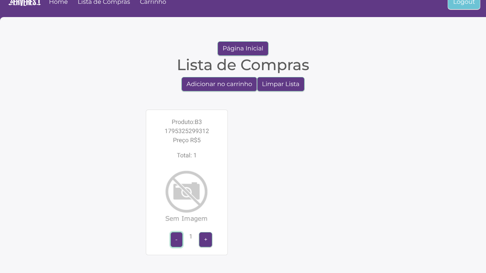

# BUG-001: Diminuir a quantidade de um item com 1 unidade não remove o item da lista

| Campo | Valor |
|---|---|
| Severidade | Média |
| Prioridade | Média |
| Status | Aberto |
| Módulo | Loja (cliente) › Lista de Compras |
| Ambiente | front.serverest.dev, Chrome. Reproduzido também numa cópia local do front |
| Caso de teste | CT-UI-LOJ-06 (automatizado, desativado com `it.skip` até a correção) |

## Passos para reproduzir

1. Entrar como cliente.
2. Pesquisar um produto e clicar em **Adicionar a lista**.
3. Na Lista de Compras, com o item em **Total: 1**, clicar no botão **-**.

## Resultado esperado

O item sai da lista e aparece a mensagem "Seu carrinho está vazio".

## Resultado obtido

Nada acontece. O item continua na lista com **Total: 1**, e não há outra forma de remover só esse item além de **Limpar Lista**.



## Causa provável

Em `src/services/cart.js`, a função `deleteItem` filtra os itens pelo campo `id`:

```js
arrayProducts.filter(({ id: itemId }) => (itemId !== id));
```

Mas os itens da lista são gravados com `_id`. Como `id` é sempre `undefined`, o filtro mantém todos os itens.

## Sugestão de correção

Filtrar por `_id`: `arrayProducts.filter(({ _id }) => _id !== id)`.
