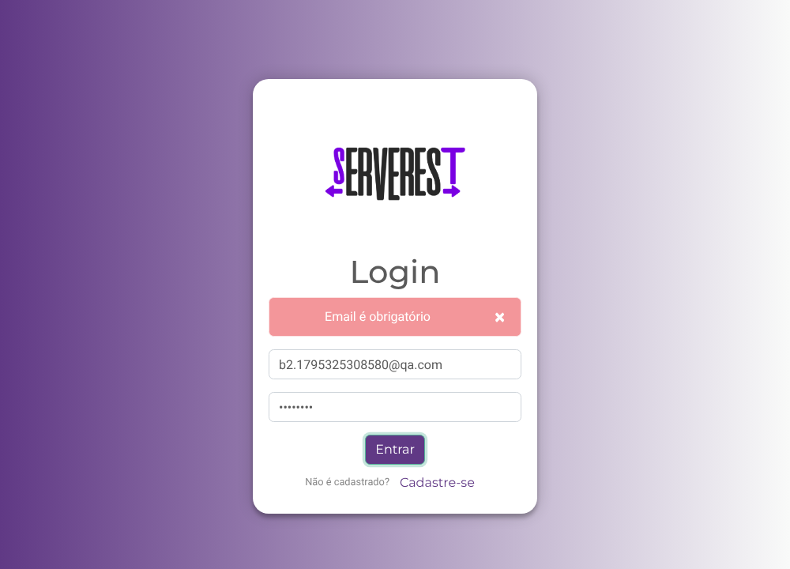

# BUG-002: Depois de errar a senha, corrigir só a senha não faz login ("Email é obrigatório")

| Campo | Valor |
|---|---|
| Severidade | Alta (bloqueia o login no fluxo mais comum de erro) |
| Prioridade | Alta |
| Status | Aberto |
| Módulo | Login |
| Ambiente | front.serverest.dev, Chrome. Reproduzido também numa cópia local do front |
| Caso de teste | CT-UI-LOG-06 (automatizado, desativado com `it.skip` até a correção) |

## Passos para reproduzir

1. Abrir a tela de login.
2. Informar um e-mail cadastrado e uma senha errada. Clicar em **Entrar**.
3. Ver a mensagem "Email e/ou senha inválidos".
4. Sem mexer no e-mail, apagar a senha, digitar a senha correta e clicar em **Entrar**.

## Resultado esperado

O usuário entra no sistema.

## Resultado obtido

Aparece "Email é obrigatório" e o usuário continua na tela de login, mesmo com o e-mail preenchido no campo. Só funciona se o usuário apagar e digitar o e-mail de novo.

## Causa provável

Em `src/views/login.js`, o tratamento de erro faz `this.setState(estadoInicial)`, que zera `formData`. Os campos, porém, não são controlados pelo estado (não têm `value`), então o e-mail continua visível na tela, mas não é enviado de novo.

## Sugestão de correção

Não limpar `formData` depois do erro, ou tornar os campos controlados (`value={this.state.formData.email}`), para que a tela e o estado fiquem iguais.
